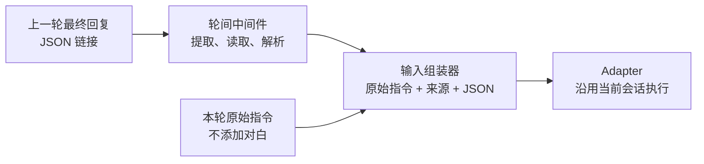

# EvalP 轮间中间件方案

| 项目 | 内容 |
| --- | --- |
| 文档状态 | 首期已实施并验证；正文保留设计依据，实施状态见第 14 节 |
| 日期 | 2026-11-02 |
| 目标 | 在同一会话的两轮对话之间处理上一轮产物，并传给下一轮 |
| 首期能力 | 提取上一轮 JSON 链接、读取并解析内容、附加到本轮输入 |
| 后续能力 | 更多处理器、重放、多轮评测与缓存 |

本文保留原方案的产品行为和技术决策。2026-11-02 用户授权实施后已完成首期，
实施结果及限制见第 14 节；当前生效接口以 [api.md](api.md) 为准。

## 1. 需求与示例

用户希望在同一会话内，为下一轮对话添加中间件，处理上一轮的产物并传递给 Agent。

典型流程：

1. 第一轮生成故事或其他业务产物，回复中包含 JSON 链接。
2. 第二轮输入或选择“不添加对白”，并启用“读取上一轮 JSON”。
3. 平台提取链接，下载并解析 JSON。
4. 平台将本轮指令、来源链接和 JSON 内容组合为实际输入。
5. Agent 在同一会话内继续执行第二轮。

**需求解释：**本文将“不添加对白”理解为第二轮的业务指令或业务选项。它不是“本轮不输入消息”，也不是中间件名称。是否设计对白由 Agent 的业务逻辑处理，中间件负责产物传递。

示意输入如下，链接和 JSON 均为说明性示例：

```text
不添加对白

【上一轮产物】
来源链接：https://artifacts.example.com/story.json
JSON 内容：
{"title":"故事标题","scenes":[{"summary":"场景描述"}]}
```

原始指令完整保留；平台不移除业务前缀，也不改写业务选项。

## 2. 当前实现与接入依据

以下事实来自当前工作区，工作区中已有尚未提交的相关改动。后续实施应基于当时的工作区再次核对。

| 已有能力 | 实现位置 | 对方案的影响 |
| --- | --- | --- |
| 单轮请求包含 `input`、`variables` 等字段，尚无轮间处理配置 | [schemas/session.py](../backend/evalp/schemas/session.py)，`TurnCreate` | 扩展可选请求字段，保持旧调用兼容 |
| 创建轮次、占用会话执行槽位、组装历史、后台执行与收尾 | [services/session.py](../backend/evalp/services/session.py)，`SessionService.run_turn`、`_execute` | 会话服务负责来源校验和处理配置快照 |
| 历史只包含成功轮次的 `input` 与 `output.messages` | 同上，`get_history` | 新轮次需使用实际输入重建历史 |
| 超时、取消、事件补齐、结果与指标汇总 | [runtime/runner.py](../backend/evalp/runtime/runner.py)，`Runner` | 中间件必须在同一执行预算内运行 |
| 所有适配器接收 `history` 与 `user_input: Message` | [runtime/adapters/base.py](../backend/evalp/runtime/adapters/base.py) | 首期可沿用适配器接口 |
| HiAgent 直接接入复用上游会话，发送 `Query=user_input.text()` | [runtime/adapters/hiagent_adapter.py](../backend/evalp/runtime/adapters/hiagent_adapter.py) | 解析后的 JSON 必须进入本轮实际文本输入 |
| 输入区支持本轮变量，非空文本才能发送 | [MessageInput.tsx](../frontend/src/components/session/MessageInput.tsx) | 增加按轮选择中间件的交互 |
| 已有 Span、事件大内容转存、BlobStore 与 GC | [services/event_sink.py](../backend/evalp/services/event_sink.py)、[store/gc.py](../backend/evalp/store/gc.py) | 复用 Trace 与内容存储基础设施 |

现有设计依据：[详细设计](02-详细设计.md)第 6、7、9 节、[偏离记录](DEVIATIONS.md)、[HiAgent 接入指南](hiagent-接入指南.md)。

## 3. 首期范围与推荐行为

### 3.1 首期范围

- 普通会话中，从第二轮起按轮次添加中间件，仅对本轮生效。
- 首期提供一个内置处理器 `json_artifact@1.0.0`。
- 支持从上一轮最终回复提取 JSON 链接，读取全文或指定字段。
- 将处理结果附加为文本，传给配置型、HTTP、子进程和 HiAgent 适配器。
- 保存处理配置、来源、结果和实际输入，支持刷新后查看。
- 记录处理中、成功、失败、取消与超时。
- 中间件会话可正常查看历史和做只读对比。

首期不提供自定义脚本执行、工作流编辑器、自动发起下一轮、会话级自动继承、跨会话读取产物、文件上传传输或变量注入模式。

### 3.2 推荐决策

| 决策 | 推荐行为 | 原因 |
| --- | --- | --- |
| 配置归属 | 挂在即将执行的下一轮 | 能准确说明哪一轮消费了产物 |
| 默认状态 | 关闭，按轮显式选择 | 保持现有会话行为 |
| 默认来源 | 紧邻上一轮，要求成功完成且有最终回复 | 避免读取部分输出或悄悄跳过失败轮次 |
| 多链接 | 展示候选，由用户明确选择 | 避免选错业务产物 |
| 传递内容 | 本轮指令、来源链接、解析后的 JSON | 下一轮可直接消费内容，并保留出处 |
| 失败策略 | 停止本轮，保留错误与配置 | 避免缺少产物仍继续业务流程 |
| 数据保存 | 原始输入与实际输入分别保存 | 用户意图与真实执行都可核对 |
| 执行顺序 | 创建轮次后、调用 Adapter 前处理 | 与取消、超时、Trace 和收尾统一 |

显式提供来源轮次时，可引用同一会话中较早的成功轮次，主要用于中间件失败后的重试。首期界面不提供任意历史轮次选择器；重试沿用用户此前已选择的来源，不自动切换来源。

## 4. 数据流与模块边界



拟新增的模块：

| 模块 | 职责 |
| --- | --- |
| `schemas/middleware.py` | 处理配置、处理快照和候选产物的 DTO |
| `runtime/middleware/base.py` | 中间件上下文与结果契约 |
| `runtime/middleware/registry.py` | 注册内置处理器、校验固定版本和配置 |
| `runtime/middleware/json_artifact.py` | 提取候选、下载、解析与字段选择 |
| `services/middleware.py` | 来源校验、候选查询、快照与结果持久化 |

会话服务负责确定本轮配置和来源，Runner 在超时与取消控制内执行输入准备，适配器接收准备好的 `Message`。中间件不修改上一轮输出，也不直接发起模型请求。

首期将中间件输出定义为结构化 JSON 值及来源信息，由统一输入组装器序列化。以后新增处理器可继续复用此契约，无需让每个处理器自行拼接业务指令。

## 5. JSON 处理规则

### 5.1 提取来源

默认只读取来源轮次的 `output.final`，不扫描思考过程、所有工具事件或失败轮次的部分文本。

支持：

- JSON 格式的最终回复：从 JSON 相关字段中提取链接。
- 回复中的 JSON 代码块：解析后提取链接。
- Markdown 链接与裸 URL：识别 `.json` 路径，允许携带签名查询参数。
- 配置 `url_pointer`：按 JSON Pointer 指定最终回复对象中保存链接的字段。

不通过 LLM 猜测目标链接。对下载地址无 `.json` 后缀且字段含义不明确的产物，使用 `url_pointer` 显式指定。

候选提取应保留 URL 的原始签名参数；去重不能改写签名 URL。候选 ID 根据来源与原始 URL 确定，相同来源和配置重复查询应得到相同候选。

### 5.2 候选选择

只有一个候选时自动选中；多个候选时要求 `selected_candidate_id`。该 ID 必须来自指定来源轮次与当前配置的候选集合，不能通过参数传入任意下载地址。

没有候选时提示“上一轮未找到 JSON 产物”，允许调整链接字段配置。候选查询只解析已保存的回复，不访问外部链接。

### 5.3 读取与解析

下载完成后校验 HTTP 状态，并实际解析 JSON；不能只依据扩展名或 `Content-Type` 判断有效性。

支持 JSON 对象和数组。首期建议拒绝标量顶层值，避免把普通文本误当作业务产物。

`content_pointer` 用于从下载后的 JSON 中选择字段，缺省传入全部内容。字段不存在应明确失败，不能替换成空对象。

JSON Pointer 使用 `/story/scenes` 等形式；它与从最终回复中取链接的 `url_pointer` 属于两个不同步骤。

### 5.4 输入组装

按“完整原始指令 → 产物来源 → JSON 内容”的固定顺序生成一个用户消息。中间件仅支持文本输入及只包含文本块的用户消息；其他多模态输入首期明确提示不支持。

JSON 内容采用标准序列化，作为数据段附加，不提升为系统消息。中间件不增删 JSON 的业务字段，除非用户配置了字段选择。

建议初始限制为下载内容最多 1 MiB、组合后的输入最多 64 KiB、下载超时 15 秒；这些是待评审默认值，实施时结合适配器限制配置。

超过输入上限时要求选择更小的字段范围，不能静默截断 JSON。保存处理快照时记录原始内容哈希与所选字段。

下载范围按产物存储域名配置；重定向目标也需要校验。签名链接原样用于读取，上游 Agent 凭据不自动转发给产物服务器；额外读取凭据如有需要，通过 SecretStore 引用提供。

## 6. 拟新增接口

以下接口和字段均为提案，尚未实现。

### 6.1 查询处理器

```http
GET /api/v1/middlewares
```

返回处理器的 ID、版本、展示名称、配置 Schema 和支持的输入模式。首期只有 `json_artifact@1.0.0`。

### 6.2 查询来源轮次的产物候选

```http
GET /api/v1/sessions/{session_id}/turns/{source_turn_id}/artifact-candidates
```

可选查询参数 `url_pointer`。响应包含 `source_turn_id`、候选 ID、原始链接与来源字段位置。

接口校验来源属于当前会话且成功完成。最终回复已保存于平台，因此该接口不下载远端 JSON，也不创建新轮次。

### 6.3 发起下一轮

扩展现有接口，增加可选 `middlewares` 列表：

```http
POST /api/v1/sessions/{session_id}/turns
```

```json
{
  "input": "不添加对白",
  "middlewares": [
    {
      "id": "json_artifact",
      "version": "1.0.0",
      "source_turn_id": "trn_previous",
      "config": {
        "url_pointer": "/jsonUrl",
        "selected_candidate_id": null,
        "content_pointer": null
      }
    }
  ],
  "wait": false
}
```

示例中的 `trn_previous` 为说明性占位 ID；实际请求使用来源轮次真实 ID。

`url_pointer`、`selected_candidate_id` 和 `content_pointer` 都可缺省。首期限制列表长度最多为 1，结构上保留以后按序组合多个处理器的能力。

省略 `middlewares` 或传空列表时沿用原有行为。保留 `input` 必填与现有 `202 / wait=true` 响应模式，不以业务文本自动触发中间件。

创建轮次前校验处理器版本、配置、来源归属与来源状态；在会话执行槽位内固定来源，防止候选查询后其他客户端发起新轮次导致来源变化。对默认“上一轮”选择发生变化的情况返回 `409 ARTIFACT_SOURCE_CHANGED`，要求刷新来源。

处理器在后台读取失败时，通过轮次终态与错误字段反馈，不让发起请求一直等待下载。

## 7. 存储与兼容

### 7.1 轮次字段

拟通过新的 Alembic 迁移，为 `turns` 增加两个可空 JSON 字段：

| 字段 | 含义 |
| --- | --- |
| `effective_input` | 成功准备、保存并交给 Adapter 的实际 `Message` |
| `middleware_snapshot` | 请求配置、固定来源、处理状态、结果引用和耗时 |

原有 `input` 保持为完整用户原始输入。未启用中间件时，`effective_input` 可为 `NULL`，读取时回退到 `input`。处理中或失败时不能把未完成的输入当作已发送输入。

快照建议包含 `schema_version` 和 `steps`。每个步骤记录 `id`、`version`、`config`、`source_turn_id`、`status`、`duration_ms`、`result_blob_hash` 与结构化错误。

`TurnOut` 增加对应可选字段，旧客户端可以忽略；首期不改 AgentSpec，也不改变历史版本哈希。

### 7.2 持久化顺序

处理成功后，将实际输入和处理快照保存完成，再调用 Adapter。保存失败时停止执行，不能先调用 Agent 后补写关键输入。

中间件失败后保存失败快照，`effective_input` 保持为空。已保存但尚未调用 Adapter 时发生取消，可保留准备结果，轮次状态说明本轮已取消，不能宣称上游已收到请求。

使用 BlobStore 保存下载结果和处理元信息，包括原始内容、解析结果、选取范围与内容哈希。登记独立引用；不能依赖 Trace 的大 payload 引用代替轮次结果引用。

会话清理时释放轮次快照与事件各自持有的 Blob 引用。重放后续若复用这些内容，需要额外登记引用，确保来源清理不会破坏重放记录。

### 7.3 历史重建

成功轮次的历史输入改为：

```text
effective_input 存在 → 使用 effective_input
effective_input 不存在 → 使用原有 input
```

失败、取消和超时轮次仍不进入历史。上一轮输出保持原样，不能通过覆盖它来注入 JSON。

HiAgent 由上游维护会话历史，平台将组合后的内容作为当前轮 `Query` 发送，不重复发送完整本地历史。

## 8. 执行生命周期与 Trace

推荐时序：

1. 校验请求与来源，占用会话槽位，创建 `running` 轮次。
2. Runner 发出唯一的 `turn.start`，开始本轮超时和取消控制。
3. 发出中间件根 Span 及提取、读取、解析子 Span。
4. 处理成功，保存实际输入、内容引用和快照。
5. 在根 Span 结果中公开实际输入及处理摘要。
6. Adapter 接收实际输入并执行，继续正常流式事件。
7. 按现有方式保存输出、汇总指标、发出 `turn.end` 并释放槽位。

事件继续复用 `span.start / span.end / error`，首期不增加事件类型。步骤属性增加 `category: middleware`，以便界面区分平台处理与上游执行。

**事件语义调整提案：**中间件轮次的 `turn.start.input` 展示原始用户输入，实际输入通过中间件根 Span 的结果和 `TurnOut.effective_input` 查看。没有中间件时，两者相同，原有展示不变。当前 Runner 会覆盖 Adapter 报告的 `turn.start.input`；实施时必须避免 Adapter 再次覆盖本轮起始事件或产生重复 `turn.start`。此项需要同步记录共享事件契约变化。

中间件处理失败也必须形成完整的 `turn.start → error → turn.end`，不调用 Adapter；前端不能一直停在处理中。

本轮用时包含中间件处理，另记录 `middleware_ms`；成功轮次的用时算到收到上游最终回复（`message.assistant`）为止，回答之后的 Trace 补齐另记 `trace_fetch_ms`，不计入本轮用时。中间件不增加 LLM、工具调用数，也不冒充 HiAgent 上游耗时。首输出耗时继续反映用户等待时间，包含输入准备。

## 9. 前端交互

在现有“本轮变量”附近增加可展开的“轮间中间件”入口。

| 情况 | 展示与行为 |
| --- | --- |
| 首轮，无来源产物 | 入口禁用，提示需要上一轮结果 |
| 上一轮正在运行 | 继续沿用不可发送状态 |
| 选择读取 JSON | 展示来源轮次、候选链接和可选字段配置 |
| 多个候选 | 必须选择一个再发送 |
| 未开启中间件 | 保持现有输入与发送行为 |
| 发送后处理中 | 显示“正在读取上一轮 JSON”，支持停止 |
| 处理成功并执行 | 原始指令附加“已附带上一轮 JSON”标记 |
| 处理失败 | 显示错误，保留本轮配置与原始指令供重试 |

原始指令仍是对话区的主要内容；实际发送内容折叠展示。可查看来源、所选字段、JSON 内容和处理耗时，大内容按需加载。

发送被接受后，草稿在处理中失败时仍应能恢复，避免现有“POST 成功即清空输入”的行为导致用户无法重试。只有本轮完成预期执行后才按正常行为清理本轮配置；配置不自动应用到下一轮。

首期不增加预执行下载预览。用户选择时查看候选，执行后查看冻结的实际内容，避免预览与正式发送分别下载造成内容不一致。

## 10. 异常、取消与重试

拟新增的错误码：

| 错误码 | 情况 | 行为 |
| --- | --- | --- |
| `ARTIFACT_SOURCE_INVALID` | 来源不存在、不属于当前会话或未成功完成 | 拒绝请求或阻止处理 |
| `ARTIFACT_SOURCE_CHANGED` | 默认上一轮已变化 | 刷新候选，重新选择 |
| `ARTIFACT_NOT_FOUND` | 没有匹配的 JSON 链接 | 保留配置，允许调整字段 |
| `ARTIFACT_AMBIGUOUS` | 多链接未选择或候选选择不再有效 | 展示候选，要求明确选择 |
| `ARTIFACT_FETCH_FAILED` | 读取失败、地址过期或状态异常 | 停止本轮，显示原因 |
| `ARTIFACT_INVALID_JSON` | 下载内容无法解析或顶层类型不支持 | 停止本轮 |
| `ARTIFACT_FIELD_NOT_FOUND` | 所选 JSON 字段不存在 | 提示调整选择 |
| `ARTIFACT_TOO_LARGE` | 下载或组合输入超过限制 | 提示选择更小字段范围 |

本轮总超时和用户取消沿用 `TIMEOUT` 与 `cancelled` 状态。处理阶段取消应关闭下载连接，正常保存终态并释放会话槽位。

首期不自动重试整个轮次。用户重试时保留原始指令、来源与配置，并明确创建新的执行尝试；不能重复提交一个已被上游接受但结果未知的请求。

链接失效后，如果此前已成功保存内容，可在后续扩展中提供“使用保存的产物快照”。首期失败重试重新读取明确选择的来源链接，不宣称过期链接可自动恢复。

## 11. 重放、评测与业务桥接

### 11.1 首期兼容策略

普通会话及历史只读对比支持中间件记录。

重放服务在首期需识别被重放轮次及其必要历史是否包含中间件；如果相关路径尚未支持，明确返回不支持的原因。不能只复制原始指令而忽略产物传递。

首期不让中间件作为评测配置生效，也不让它隐式改变已有数据集的执行行为。

### 11.2 第二阶段

| 能力 | 规则 |
| --- | --- |
| 锚定重放 | 复用原轮次实际输入和冻结的产物快照，不重新下载 |
| 自由重放 | 复用原始指令及处理器配置，基于新会话此前输出重新处理，逐轮串行 |
| 只选部分轮次 | 校验产物依赖；缺少来源时明确失败，不能隐式改用原会话产物 |
| 多轮评测 | 用例每轮可配置处理器；读取失败按执行失败处理 |
| 评测缓存 | 处理器 ID、版本、配置进入用例哈希；外部固定输入内容参与缓存身份 |

自由重放不能照搬原配置中的来源轮次 ID，需要映射到新会话的对应产物轮次。HiAgent 直接接入由上游维护历史、忽略外部历史，每个会话只对应一个上游会话；因此对绑定直接 HiAgent 适配器的版本，发起锚定重放会被拒绝（`ANCHORED_REPLAY_UNSUPPORTED`，提示改用自由重放），自由重放仍逐轮串行可用。保留 `business_bridge` 的版本仍通过 HTTP 协议收到历史，不受此限制。

对运行中才产生的远端产物，应区分“复用一次已保存的整段评测结果”和“重新执行并下载新产物”。后者的外部内容可能变化，不能仅凭链接相同就复用缓存。

### 11.3 现有业务桥接

当前偏离记录说明部分业务桥接已有业务 JSON 消费逻辑。实施前需要核对最终请求，明确：

- 通用平台层负责选取、读取、解析与传入。
- 业务层负责业务 Schema 校验与业务执行。
- 同一产物不会被平台与桥接重复附加。
- 完整原始指令及业务前缀在实际业务入口仍可核对。

如某个兼容桥接尚不能接收平台组合输入，应先在该接入上禁用此功能并说明原因，不能以请求被接受作为兼容验收完成。

## 12. 实施任务与验证

| 顺序 | 任务 | 验证入口 |
| --- | --- | --- |
| 1 | 请求、响应、处理器契约与新增迁移 | 旧请求兼容、迁移、来源校验 |
| 2 | 内置 JSON 处理器及候选查询 | 链接格式、字段选择、下载限制与异常 |
| 3 | Runner 输入准备、结果保存、历史与 GC | 事件顺序、实际输入、取消、终态、引用 |
| 4 | 会话输入区、结果标记与 Trace 展示 | 候选选择、失败恢复、刷新回放 |
| 5 | 重放限制及适配器兼容验证 | 不丢失中间件语义、桥接不重复消费 |
| 6 | 相关回归与项目要求的检查 | 现有普通会话、对比、评测行为 |

首期建议单 Agent 串行实施，共享输入与事件契约稳定后再判断是否需要拆分。本文不授予提交、发布、部署或调用真实模型的权限。

验收用受控 HTTP 产物服务与 Fake Agent，不调用真实模型：

- [x] 第一轮返回 JSON 链接，第二轮传入完整“不添加对白”指令、来源链接和解析结果。
- [x] 可选取最终回复中的链接字段和下载内容中的业务字段。
- [x] 多候选必须明确选择，不把图片或视频链接误当作 JSON。
- [x] 无候选、过期链接、非法 JSON、字段缺失、下载超时和体积超限均明确失败。
- [x] 失败时不调用 Agent，输入草稿和中间件配置可恢复。
- [x] 处理中取消后连接关闭、轮次结束、会话可继续使用。
- [x] 保存实际输入失败时不调用 Agent（包含 Blob 失败与事务提交失败）。
- [x] 原始指令及业务前缀完整保留，实际请求内容可核对。
- [x] 刷新后仍能查看来源、配置、处理结果和实际输入。
- [x] 下一轮本地历史包含实际输入；失败轮次不进入历史。
- [x] 原始产物链接失效后，已保存的处理结果仍可查看。
- [x] 中间件耗时单独展示，不增加 LLM 或上游工具调用数。
- [x] 清理会话后按各自引用释放产物和事件 Blob。
- [x] 关闭中间件时，旧接口、事件与会话行为保持兼容。
- [x] 不支持的中间件重放明确拒绝，不静默丢失产物。
- [x] HiAgent 直接 Query 与会话复用受控验证；未验收的业务桥接明确禁用。

完成针对性验证后，按仓库开发约定运行后端 `pytest tests -q`、`ruff check backend tests` 和前端 `npm run typecheck`、`npm run lint`、`npm test`。

实现验证后再按授权更新 `api.md` 与 `DEVIATIONS.md`，记录新增存储字段、事件输入语义和阶段性兼容限制。仅生成本方案时不把提案写成已实现事实。

## 13. 待确认事项

以下为原方案评审事项。用户已授权按首期方案实施，所选默认值与剩余业务限制见第 14 节：

| 项目 | 当前推荐 | 确认方式 |
| --- | --- | --- |
| “不添加对白”的含义 | 第二轮业务指令，指令与 JSON 同时传入 | 需求评审 |
| 实际产物格式 | 最终回复中的 JSON 链接，必要时指定字段 | 以一份脱敏实际回复样例确认 |
| JSON 业务结构 | 通用处理器读取对象或数组，业务层校验 Schema | 以一份脱敏产物样例确认 |
| 下载授权 | 存储域名与独立凭据引用 | 根据实际产物存储确认 |
| 初始限制 | 下载 1 MiB、实际输入 64 KiB、读取 15 秒 | 根据产物规模与适配器限制确认 |
| 首期传入方式 | 指令、来源链接和 JSON 文本 | 方案评审 |
| 重放与评测 | 第二阶段开放，首期明确限制 | 范围评审 |

后续评审如调整这些行为，应更新本方案；实施不能把尚未验证的业务兼容性直接视为已确认。

## 14. 首期实施结果（2026-11-02）

已实现处理器目录、候选查询、按轮配置、JSON 字段选择、原指令附加、输入准备与独立 Blob
事务持久化、取消/超时终态、实际历史重建、权限/GC，以及会话页的选择、结果折叠查看和失败恢复。
前端使用现有 Trace 展示处理根步骤及提取、读取、解析子步骤。迁移 `0007` 为旧数据保留 NULL。

默认限制采用下载 1 MiB、实际输入 64 KiB、读取 15 秒。配置 `artifacts.allowed_hosts`
（逗号分隔精确域名）后才允许下载；默认空值禁止读取。重定向、签名 URL、无凭据转发、
非标准 JSON 数值和超限均已受控验证。暂不支持产物独立认证配置。

配置型 Fake LLM、HTTP SDK Agent、子进程 SDK Agent 和模拟 HiAgent 发布 API 均已验证实际输入；
直接 HiAgent 复用上游会话。现有业务 `business_bridge` 仍未验证平台组合输入的业务消费，
首期在前后端明确禁用此接入；评测配置与中间件重放未开放。实施阶段未调用真实模型，也没有提交。
经用户授权，2026-11-02 已部署至本机 `http://127.0.0.1:7860`，上线核验见下文。

验证记录：

- 后端全量回归：`PYTHONPATH=backend .venv/bin/pytest tests -q`，1192 通过、1 跳过。
- 最终中间件、适配器与迁移专项：52 通过；包括后续补充的签名链接、下载总超时、输入提交失败与 GC 双引用。
- `ruff check backend tests` 通过；前端类型检查与 lint 通过。
- 前端全量测试：64 个测试文件，559 通过；生产构建通过。

本机 `.venv` 的可编辑安装原先指向另一份旧仓库，因此后端验证显式设置当前工作区 `PYTHONPATH`。
本机没有可用 Node 命令，使用 `.venv/node-runtime` 中的临时 Node 22 运行前端工具，
构建核验输出在 `.venv/frontend-build`，部署镜像已使用该产物。

### 14.1 本机部署与核验

本次没有新增依赖包，复用现有镜像依赖与已验证的前端产物，使用已准备好的
`evalp:middleware-20261102` 增量镜像完成容器切换，没有重新安装依赖或执行完整镜像构建。
新容器继续挂载原平台数据目录，仅在宿主机回环地址开放 7860 端口。
产物允许域名通过 `artifacts.allowed_hosts` 配置，具体业务配置保存在本地。

切换前确认无运行中的轮次或评测任务，停止服务后完成数据库备份及完整性检查，
备份位于 `build/middleware-deploy-20261102T072419Z/evalp-before-0007.db`。
旧容器保留为 `evalp-before-middleware-20261102`；如需回退到旧代码，应配套处理数据库迁移，
不能在产生新数据后直接覆盖数据库。

上线核验通过：

- 容器加载 `/opt/evalp-current/evalp` 中的新代码，数据库迁移由 `0006` 升至 `0007`。
- Agent、版本、资产、修订、会话和轮次数量保持一致；
  历史版本 ID、Spec 和 Spec 哈希的整体校验值一致；旧轮次的新增字段仍为 NULL。
- 首页、鉴权初始化、健康接口、中间件目录和轮次详情均正常响应；执行队列为空。
- OpenAPI 包含候选接口、按轮中间件配置、实际输入和处理快照字段。
- 服务返回的首页及核验的会话页面脚本、共享脚本和样式与现有构建产物一致；
  脚本包含“轮间中间件”和失败轮次恢复入口。
- 已有成功轮次可通过候选接口提取 JSON 产物候选，未下载远端产物，也未调用真实模型。
